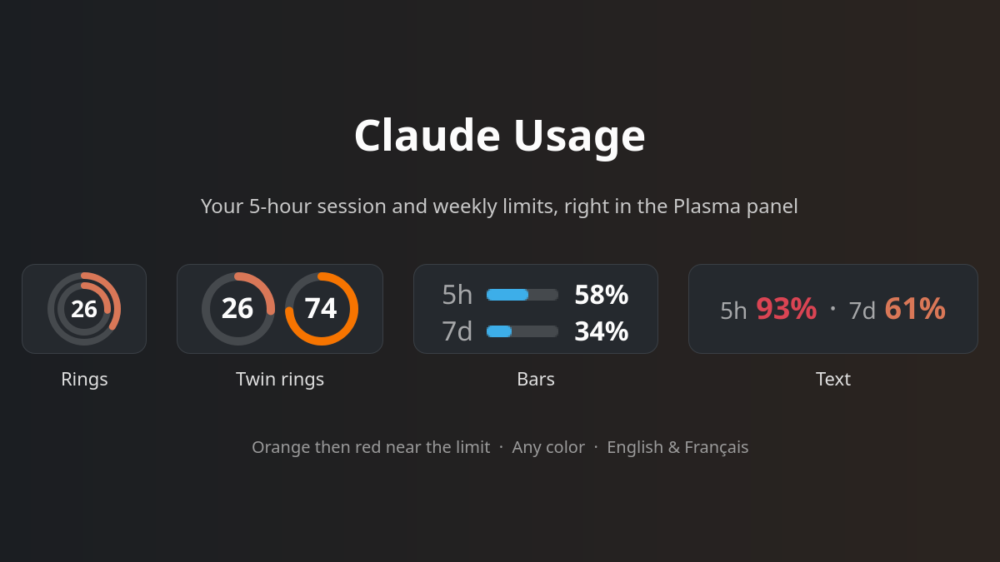

# Claude Usage

See how much of your Claude plan you have used, right in the Plasma panel:
the **5-hour session** limit and the **weekly** limit, with the time left before each one resets.

It shows the same numbers as the `/usage` command of Claude Code and the
[usage page](https://claude.ai/settings/usage) on claude.ai.

> Unofficial widget, not affiliated with Anthropic.



## Features

- Four panel designs, chosen with a live preview in the settings:
  **Rings** (week outside, session inside), **Twin rings**, **Bars** and **Text**
- Works in horizontal and vertical panels, and on the desktop
- Click for details: reset times, model-specific weekly limits, usage split by app
- Colors: terracotta, theme accent, green or any custom color;
  optionally turns orange then red when getting close to a limit (thresholds adjustable)
- Refreshes every 5 minutes (adjustable), when the popup opens, and right after a limit resets;
  middle-click to refresh now
- Text color: automatic (follows the panel theme), light, dark or custom
- English and French, chosen in the settings (or the system language)

## Requirements

- Plasma 6
- [Claude Code](https://claude.com/claude-code), signed in with a Claude Pro or Max account
  (the widget reuses its sign-in from `~/.claude/.credentials.json`)
- `curl`, and `jq` or `python3`

## How it works

Every few minutes, [`contents/code/fetch-usage.sh`](contents/code/fetch-usage.sh) reads the
Claude Code access token and asks `https://api.anthropic.com/api/oauth/usage` for the current usage.
The token is only sent to Anthropic, never stored or logged by the widget.

Claude Code renews its sign-in when it runs. If you have not used it for a while, the widget
shows a warning: open Claude Code once and the numbers come back.

This endpoint is the one Claude Code itself uses; it is not a public, documented API and may change.

## Install

**From Plasma:** right-click the panel → *Add Widgets…* → *Get New Widgets…* →
*Download New Plasma Widgets* → search for **Claude Usage**.

It is also on the [KDE Store](https://store.kde.org/p/2380745), and each version is attached to the
[GitHub releases](https://github.com/Elwynn18/plasma-widgets/releases).

**From source:**

```sh
scripts/install.sh claude-usage
```

Then right-click the panel → *Add Widgets…* → search for **Claude Usage**.
